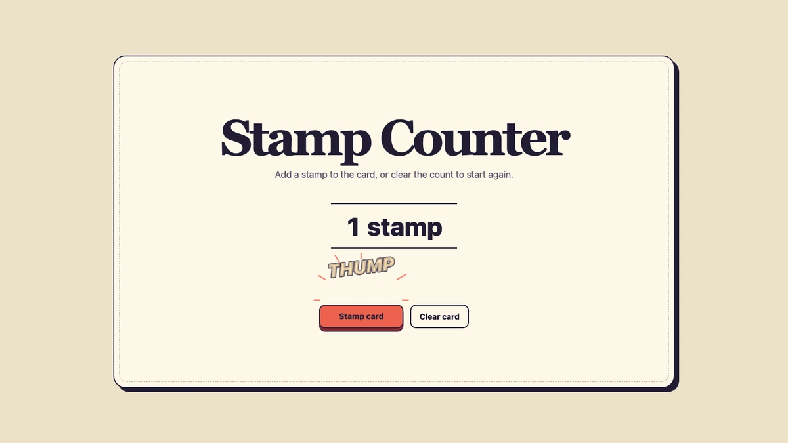

# Anime UI Effects

Stamp Counter is a single-file browser demo of an anime-inspired button reaction. Press Stamp card to add to the count. A CSS spring eases out of the pressed shape while a canvas draws a burst and hand-lettered-style impact text above the control.

## Run it

Download [index.html](index.html) and open it in a browser. There are no dependencies, network requests or build steps. Stamp card works with a pointer, Enter or Space. Clear card resets the count. The operating system's reduced-motion setting suppresses both the spring and the canvas burst.

The button and count use native HTML. One pointer-transparent canvas overlays the demo panel and only redraws while a burst is active. Change the CSS custom properties at the top of the file to adapt the colors and the spring easing.

[MIT license](LICENSE)
